# formatscout

[](https://www.python.org/downloads/)
[]()
[](LICENSE)
[](https://pypi.org/project/formatscout/)
[](https://github.com/rymorrisj/formatscout/actions)
[]()


Multi-tier format-identification for disk images and directory trees. Pure Python 3.11+ stdlib. Zero third-party runtime dependencies.

Given a path, `detect()` returns a `ScanResult`: `title`, `platform`, `era`, `confidence` (0.0-1.0), a `reason`, optional `requires_install`/`requires_extraction` flags, and `warnings`, plus a `status`, `method` and `authoritative` flag that say how to read it (see [Result contract](#result-contract)). It never raises. A garbage or unreadable path returns `confidence=0.0` with an explanatory reason instead of an exception.

Originally built for [Peach 1UP](https://github.com/rymorrisj/peach_1up), an emulator orchestration platform for retro media preservation. Extracted into a standalone package to help others do the same.

## Install

```bash
pip install formatscout
```

Or from source, for contributors:

```bash
git clone https://github.com/rymorrisj/formatscout.git
cd formatscout
uv pip install -e .
uv pip install pytest  # only needed to run the test suite
```

Or with plain pip:

```bash
pip install -e .
pip install pytest
```

Requires Python 3.11+ (`magic_detect.py` reads `magic_signatures.toml` via stdlib `tomllib`, added in 3.11).

## Detection pipeline

For a file, Tier 1 runs first and returns immediately on any hash hit (sha1, md5 or crc32) whose index entry has a non-None `era`. Otherwise one branch is chosen by file suffix, and that branch's result is final: no later tier is consulted, even if it returns low confidence or `era=None`. Directories skip Tier 1 and go straight to directory heuristics. There is no confidence threshold in the pipeline. The table below lists signal types, not a cascade.

| Tier | Resolution Strategy | Description | Confidence Range |
|---|---|---|---|
| 1 | Hash Lookup | Full-file SHA-1 (MD5/CRC32 fallback) matched against the preservation index cached at `~/.formatscout/hash_index.json`. CHD containers match on the embedded `rawsha1` header field instead of raw file bytes. | 1.0 |
| 2 | Magic Bytes | Header signature matching at fixed byte offsets. Covers PS1, PS2, N64, NES, Dreamcast. | 0.9 |
| 3 | Structural Parsing | ISO 9660 PVD sector inspection, CHD v5 metadata walking, PE executable subsystem/OS parsing. | 0.3 – 0.9 (0.3 is the CHD CHTR/CHT2 size guess) |
| 4 | Directory Heuristics | AUTORUN.INF targets, root-level system markers (PS3_DISC.SFB, I386, SYSTEM.CNF, WIN98/95), depth-2 executable scans. | 0.4 – 0.9 |
| 5 | Extension & Size | File extension alone, or extension plus size for ambiguous cases (e.g. 4 GiB optical boundary). | 0.2 – 0.7 |

Diagram reflects the actual code path in `detector.py`, `iso_detect.py`, and `directory_detect.py`. If it disagrees with the table above, trust the diagram.

```mermaid
flowchart TD
    Start(["detect(path, dir_cache)"]) --> Exists{"path.exists()?"}
    Exists -- "no" --> RNone["ScanResult(confidence=0.0,<br/>reason='path does not exist')"]

    Exists -- "yes" --> Hash["Tier 1: hash_lookup.lookup()<br/>sha1 (or CHD embedded rawsha1) -&gt; md5 -&gt; crc32<br/>against ~/.formatscout/hash_index.json"]
    Hash -- "era resolved (confidence 1.0 / 0.85 / 0.75)" --> Stamp
    Hash -- "no match / index missing" --> Kind{"file or directory?"}

    Kind -- neither --> RBad["ScanResult(confidence=0.0,<br/>reason='not a file or directory')"]
    Kind -- file --> FileDispatch["_detect_file(): dispatch on suffix"]
    Kind -- directory --> DirDispatch["detect_directory()"]

    FileDispatch --> ExtOnly[".nds / .xiso / .xex / .z64 family<br/>.sfc family / .nes / .pkg<br/>Tier 5: extension only, confidence 0.0-0.7"]
    FileDispatch --> GdCdi[".gdi / .cdi<br/>Tier 2 magic bytes: match -&gt; 0.9<br/>no match -&gt; Tier 5 era=dreamcast, 0.5"]
    FileDispatch --> IsoBranch[".iso -&gt; detect_iso()"]
    FileDispatch --> BinBranch[".bin -&gt; Tier 2 magic (0.9) -&gt; Tier 3 PVD (0.7-0.9)<br/>-&gt; bin_validator.resolve_bin_cue() (0.2-0.85)"]
    FileDispatch --> CueBranch[".cue -&gt; detect_cue(): find sibling .bin<br/>(none found -&gt; 0.0 + warning); found -&gt; same<br/>magic -&gt; PVD -&gt; resolve_bin_cue() chain as .bin"]
    FileDispatch --> ChdBranch[".chd -&gt; chd_validator.detect_chd_platform(): CHD v5 metadata chain<br/>CHGD tag -&gt; dreamcast 0.85; CHTR/CHT2 -&gt; ps1/ps2 by<br/>logical size, 0.3 heuristic; no tag -&gt; 0.0"]
    FileDispatch --> ImgBranch[".img -&gt; Tier 5 size fallback:<br/>era=dos 0.35 if &lt;800MB, else 0.0"]
    FileDispatch --> ExeBranch[".exe -&gt; exe_detect.detect_exe(): Tier 3 PE header<br/>MajorOSVersion/Subsystem -&gt; dos 0.65 / win98 0.75 /<br/>winxp 0.75; else 0.0"]
    FileDispatch --> NoSig["no suffix match -&gt; confidence=0.0"]

    IsoBranch --> IsoMagic["Tier 2 magic (applies_to='iso';<br/>no signature targets .iso today -&gt; always falls through)"]
    IsoMagic -- match --> IsoR1["confidence=0.9"]
    IsoMagic -- "no match" --> IsoPvd["Tier 3: detect_from_pvd()<br/>ISO 9660 PVD @ sector 16"]
    IsoPvd -- "PS3_DISC.SFB in root dir" --> IsoR2["era=ps3, 0.9"]
    IsoPvd -- ".XBE in root dir" --> IsoR3["era=xbox, 0.8"]
    IsoPvd -- "volume label / publisher keyword" --> IsoR4["era=winxp/win98/win95/dos/ps1/ps2, 0.7-0.75"]
    IsoPvd -- "no PVD signal" --> XboxImg["xbox_image.detect_xbox_image_type()<br/>(internal module, byte-offset check only)"]
    XboxImg -- "'xiso' (XDVDFS magic @ 0x10000)" --> IsoR5["era=xbox, 0.9"]
    XboxImg -- "'dvd_rip' (ISO9660 magic, size &gt; 4GB)" --> IsoR6["era=xbox, 0.9<br/>requires_extraction=True"]
    XboxImg -- "'iso9660' (container confirmed, no platform)" --> IsoFb
    XboxImg -- "'unknown'" --> IsoFb["Tier 5: _iso_size_fallback()<br/>by size vs 4 GiB / 800MB -&gt; 0.0-0.2<br/>era stays None; an iso9660 confirmation keeps<br/>confidence at 0.2 instead of 'no signal found'"]

    DirDispatch --> Autorun["Tier 4a: _detect_from_autorun()<br/>AUTORUN.INF OPEN=/RUN= -&gt; pointed .exe's PE header"]
    Autorun -- "era resolved" --> AutoR["era=dos/win98/winxp, 0.65-0.75"]
    Autorun -- "no signal" --> DirHeur["Tier 4b: _detect_from_directory()"]
    DirHeur -- "root marker files (PS3_DISC.SFB, XPSP/I386, WIN98/95,<br/>SYSTEM.CNF, INSTALL.*)" --> DirR3["era resolved by marker, 0.4-0.9<br/>(PS3_DISC.SFB checked first -&gt; ps3 0.9;<br/>SYSTEM.CNF via magic_detect.resolve_ps_generation_from_file)"]
    DirHeur -- "depth-2 scan (DOS tools, .WAD,<br/>split archives, .BAT, DOS-only exts)" --> DirR4["era=dos, 0.5-0.6"]
    DirHeur -- "nothing matched" --> DirR5["confidence=0.0"]

    ExtOnly & GdCdi & IsoR1 & IsoR2 & IsoR3 & IsoR4 & IsoR5 & IsoR6 & IsoFb & BinBranch & CueBranch & ChdBranch & ImgBranch & ExeBranch & NoSig & AutoR & DirR3 & DirR4 & DirR5 --> Stamp

    Stamp["_compute_requires_install(path, result.era)<br/>sets ScanResult.requires_install"] --> Final(["ScanResult returned to caller<br/>(detect() wraps all of this in try/except,<br/>any unexpected error -&gt; confidence=0.0)"])
```



PE parsing (`.exe` files and `AUTORUN.INF` targets) is handled by `exe_detect.detect_exe()` and `directory_detect._detect_from_pe()`, which both delegate the header classification (MZ/PE checks, `Subsystem` gate, `MajorOperatingSystemVersion` split) to a shared `exe_detect._classify_pe_header()` helper; only the reason text they build from it differs. `test_directory_detect.py` pins that the two stay in agreement.

`_compute_requires_install()` in `detector.py` runs after era detection and only sets `requires_install` when `era == "dos"`. A DOS-era `.iso` or `.cue` is always flagged. A DOS-era `.img` is flagged only when it is under 2 MiB. A DOS-era `.bin` is never flagged, even though its `.cue` would be. A directory is flagged when it has at least one root-level `.exe`, `.com` or `.bat`, and every one of them is on the blocklist in `utils/blocklist.py`.

## Usage

```python
from pathlib import Path
from formatscout import detect, verify, classify, hash_file

scan = detect(Path("game.iso"))
if scan.status == "identified":    # era determined from proof (scan.authoritative is True)
    ...  # scan.era, scan.title, scan.platform, scan.method
elif scan.status == "guess":       # era set, but from a heuristic: confirm before trusting it
    ...  # scan.era, scan.confidence, scan.reason, scan.warnings
elif scan.status == "ambiguous":   # no era, but scan.candidates lists the likely ones
    ...
else:                              # container_only | unsupported | no_signal | error
    ...  # scan.reason, scan.warnings, scan.issues
# scan.requires_install, scan.requires_extraction apply whatever the status

result = verify(Path("game.iso"), expected_sha1="...")
result.status  # "matched" | "mismatched" | "not_in_index" | "unchecked"

result = classify(Path("game.iso"), title="Halo", era="xbox")
result.status  # "verified" | "caution" | "mismatch" | "not_in_index" | "unchecked"

hashes = hash_file(Path("game.iso"))
hashes.sha1, hashes.md5, hashes.crc32
```

`detect()`, `classify()` and `verify()` also take a keyword-only `index_path=` to use a specific hash index, and `ensure_index()` fetches or checks the index up front. See [Hash index](#hash-index).

### Result contract

Use `status` and `authoritative`, not "is `era` None", to interpret a `ScanResult`. `era`, `confidence`, `reason` and `warnings` are unchanged: `era` is populated exactly as before, guesses included (a CHD CHTR/CHT2 size guess at 0.3, a `.img` under 800 MiB as `dos` at 0.35, extension-only matches at 0.5 to 0.7, a crc32 index hit at 0.75, an md5 hit at 0.85, a CHD header hash hit at 1.0). The new fields are keyword-only with defaults, so positional construction of `ScanResult` still works.

| `status` | `era` | Meaning |
|---|---|---|
| `identified` | set | Determined from proof; `authoritative` is True. |
| `guess` | set | **Transitional.** Set from a heuristic (size threshold, extension, directory marker, PE OS version, volume label, SYSTEM.CNF default, CHD header hash claim, md5 or crc32 hit). Exists only because `era` still carries guesses, and will be removed once it stops doing so. |
| `ambiguous` | None | The signal narrows to a few eras, listed in `candidates`. |
| `container_only` | None | Container or filesystem confirmed (`iso9660`, `chd`, `bin_cue`), but no platform. |
| `unsupported` | None | Recognised but not mapped to an era (`.nds`, an index entry with no era, a path that is neither file nor directory). |
| `no_signal` | None | Nothing usable found. |
| `error` | None | The input could not be examined (missing path, read or parse error, the `detect()` catch-all). |

`authoritative` is True only for a sha1 index hit on a non-CHD file's own bytes and a platform-unique magic signature (Dreamcast IP.BIN, N64, iNES). A CHD header `rawsha1` hit is a claim, not proof: the header is forgeable and is not checked against the hunks, so it is `guess`. An md5 hit is corroboration only until the index stores file sizes, so it is `guess` too (crc32 is likewise `guess`). Everything else is not authoritative, including the XDVDFS magic (shared by Xbox 360), PS3_DISC.SFB by name, the CHD CHGD tag (also used by NAOMI GD-ROMs) and SYSTEM.CNF (any readable file without BOOT2 reads as PS1). It is always False when `era` is None.

Other fields, all defaulted:

- `method`: the rule that produced the result. One of `hash_sha1`, `hash_md5`, `hash_crc32`, `chd_header_claim` (index hit on the CHD header's embedded `rawsha1`: a claim, not checked against the hunks), `magic`, `structural`, `system_cnf`, `directory_marker`, `pe_header`, `extension`, `size_heuristic`, `none` (no rule produced a signal).
- `container`: `iso9660`, `xdvdfs`, `chd` or `bin_cue` when confirmed, else None.
- `candidates`: `Candidate(era, tier, evidence)` tuples for `ambiguous` results.
- `evidence`: short stable codes for the specific signals, such as `pvd_volume_label_keyword`.
- `issues`: `Issue(code, message)` tuples, for example `INDEX_UNAVAILABLE` (the hash tier did not run), `POINTER_REJECTED`, `UNEXPECTED_ERROR`. `warnings` is still filled in as before.
- `platform_hint`: a platform the signal points at when `platform` is not set (for example `Nintendo DS` for `.nds`).

`Status`, `Method` and `Tier` are `StrEnum`s, so `scan.status == "guess"` works. Constructing a `ScanResult` with contradictory values (an era-less result marked authoritative, an era with a status other than `identified`/`guess`) raises `ValueError`.

`Tier` buckets a confidence value; `tier_for_confidence()` is the one mapping. The `confidence` float itself is unchanged.

| `Tier` | `confidence` |
|---|---|
| `certain` | 1.0 |
| `strong` | 0.85 to below 1.0 |
| `moderate` | 0.5 to below 0.85 |
| `weak` | above 0.0 to below 0.5 |
| `none` | 0.0 (or below, or NaN) |

`ClassifyResult` keeps its statuses and existing fields, and adds keyword-only `matched_era` (era of the matched index entry, or the era the title search was scoped to for `mismatch`), `hash_kind` (`sha1`, `chd_rawsha1`, `md5`, `crc32`, or None) and `issues` (`HASH_FAILED`, `INDEX_UNAVAILABLE`, `INDEX_MISSING`, `CHD_RAWSHA1_MISSING`). `matched_title` is still set only for `mismatch`. `VerifyResult` gains the status `unchecked` and a keyword-only `issues` (`INDEX_UNAVAILABLE`). See [Hash index](#hash-index) for what `unchecked` means.

### Public API

Twenty names are exported from `__init__.py`. Everything else is internal.

| Name | Signature | Notes |
|---|---|---|
| `detect` | `(path, dir_cache=None, *, index_path=None) -> ScanResult` | Main entry point |
| `verify` | `(path, expected_sha1, *, index_path=None, strict=False) -> VerifyResult` | Hash-only re-check against the index |
| `classify` | `(path, title, era, *, threshold=0.80, index_path=None, strict=False) -> ClassifyResult` | Five-state verification, no prior hash needed |
| `ensure_index` | `(path=None, *, force=False, timeout=None, max_bytes=None) -> Path` | Fetch or validate the hash index up front, see [Hash index](#hash-index) |
| `IndexUnavailable`, `IndexIntegrityError` | `OSError` subclasses | Index failures; `IndexIntegrityError` is a subclass of `IndexUnavailable` |
| `hash_file` | `(path) -> HashFileResult` | sha1/md5/crc32 in one read |
| `extract_embedded_sha1` | `(path) -> str \| None` | CHD v5 embedded `rawsha1`, no hunk decompression |
| `ScanResult`, `VerifyResult`, `ClassifyResult`, `HashFileResult` | N/A | Result dataclasses; see `result.py` docstrings |
| `Era` | `Literal["ps1", "ps2", ...]` | Type hint only, `ScanResult.era`'s value space; runtime values are still plain `str \| None` |
| `Status`, `Method`, `Tier` | `StrEnum` | `ScanResult.status`/`method` and `Candidate.tier` values, see [Result contract](#result-contract) |
| `Candidate`, `Issue` | `NamedTuple` | `(era, tier, evidence)` and `(code, message)` |
| `HashKind` | `Literal["sha1", "chd_rawsha1", "md5", "crc32"]` | `ClassifyResult.hash_kind`'s value space |
| `tier_for_confidence` | `(confidence) -> Tier` | The confidence to `Tier` mapping |

## Supported platforms / eras

Detection logic (tiers 2-5) covers **PS1, PS2, PS3, Xbox, Xbox 360, Dreamcast, N64, NES, SNES, DOS, Windows 95, Windows 98, and Windows XP**.

The hash index (`hash_index.json`, cached at `~/.formatscout/`) has confirmed entries for more platforms than earlier notes suggested. At minimum: PlayStation, PlayStation 2, PlayStation 3, Xbox, Dreamcast, SNES, and NES. Example entry:

<details>
<summary><b>Click to view example of an <code>hash_index.json</code> entries</b></summary>

```json
"c8a6337da7fd0b4c75f6375a79e4eea9f4da08fd": {
    "title": "Mortal Kombat Gold (Europe)",
    "platform": "Sega - Dreamcast",
    "era": "dreamcast"
}
```
</details>

**IBM PC compatible** DATs parse and index cleanly but have no `_ERA_MARKERS` mapping. Redump's PC category covers DOS/Win95/98/XP under one platform-name string, so mapping to a specific era needs a per-title resolution strategy that doesn't exist yet. These entries index with `era: null` by design, not as an error:

<details>
<summary><b>Click to view example of an <code>IBM PC compatible</code> entry</b></summary>
    
```json
"35e032ca9a5efa0cdc9b98df342351fc4b6e3714": {
    "title": "Nintendo 64 Roku Yon Total Pack for OS2.0J (Japan) (Nintendo 64 Integrated Online Manual)",
    "platform": "IBM - PC compatible",
    "era": null,
    "source": "IBM - PC compatible - Datfile (58837) (2026-06-15 06-43-57)",
    "md5": "a344a91cb48ec6e647b2c2b66d464c16",
    "crc32": "d09bab04"
}
```
</details>

**Xbox 360** has an `_ERA_MARKERS` mapping and hash-index entries, but no structural or directory detection path exists for it yet. Outside Tier 1, the only Xbox 360 signal is a `.xex` file suffix, which returns `xbox360` at 0.7 from the extension alone. Xbox 360 disc images are not separated from original Xbox: a disc image with the XDVDFS magic at 0x10000 is reported as era `xbox` whatever its generation, and so is a raw DVD rip over 4 GiB.

## Hash index

Tier 1 and `classify()`/`verify()` read a hash index (`hash_index.json`, about 88 MB). It is not bundled in the installed package.

**Which file is read.** First match wins:

1. the keyword-only `index_path=` argument of `detect()`, `classify()` or `verify()` (or the `path` argument of `ensure_index()`);
2. the `FORMATSCOUT_INDEX_PATH` environment variable (empty or blank means unset; used as given, so expand `~` in your shell);
3. the default cache, `~/.formatscout/hash_index.json`.

The home directory is looked up only when the default is needed, never at import. If it cannot be determined (and neither 1 nor 2 applies) the index counts as unavailable, see below.

**Only the default cache is managed.** If that file is missing it is downloaded on first use, over https only, size-capped, verified against a hardcoded sha256 and installed atomically together with a `hash_index.json.meta` sidecar (sha256, size, mtime, source URL) recording that this code downloaded it. A file there that carries the sidecar is re-checked against the pin once per process, and a modified one is moved aside (`hash_index.json.corrupt`, then `.corrupt.1` to `.corrupt.5`, never overwriting an earlier copy) and re-downloaded. A file there with no sidecar, or any file at another path, is yours: it gets only the size cap (256 MiB) and a JSON validity check at first use, is never downloaded to, pin-checked or moved, and a sidecar next to a non-default path is ignored. A missing file at a non-default path is not an error: `classify()` and `verify()` treat it as an empty index, and `detect()` skips the hash tier quietly.

**Implicit download is on by default.** The first `detect()`, `classify()` or `verify()` with no index in place downloads one. To avoid that, set `FORMATSCOUT_OFFLINE=1` (no download is ever attempted, an existing index is still used), point `index_path=` or `FORMATSCOUT_INDEX_PATH` at your own file, or call `ensure_index()` yourself at a time and with a timeout of your choosing. After a failed download no new attempt is made for 5 minutes (also across processes).

**`ensure_index()`** returns the resolved path once an index file is there and passes the checks below. It does not parse the index or keep anything in memory, so it is cheap to call; the first `detect()`, `classify()` or `verify()` parses it. The checks are: the file exists (downloaded first for the default cache), is readable, is within the 256 MiB load cap, and, for the managed default file, matches the download pin. JSON validity is not checked, so a user-supplied file that is not valid JSON (or not a JSON object of objects) is returned as usable and the error surfaces at first use as `IndexUnavailable` (`IndexIntegrityError`): `detect()`/`classify()`/`verify()` then report `INDEX_UNAVAILABLE` as described below, and `strict=True` raises. A managed default file that fails to parse is moved aside and re-downloaded at first use.

```python
from formatscout import ensure_index, IndexUnavailable, IndexIntegrityError

try:
    path = ensure_index(timeout=15, max_bytes=200_000_000)   # default cache: downloads if missing
except IndexIntegrityError:   # sha256 mismatch, or an oversized index file
    ...
except IndexUnavailable:      # offline mode, backoff, failed or capped download, missing or unreadable file, no home directory
    ...
```

- For the default cache it downloads when needed, as above. For any other path (explicit or from the environment) it only validates the file and raises `IndexUnavailable` if it is missing; it never downloads to it.
- `force=True` re-downloads even when a valid index exists, and skips the 5 minute backoff (never `FORMATSCOUT_OFFLINE`). The new file is downloaded and verified before anything is touched, so a failed refresh changes nothing. An unmodified copy of an earlier download is then replaced atomically; any other file at the default cache path, including an index you built there yourself, is moved aside to `.corrupt` (or the next free `.corrupt.N`) instead of being overwritten, and if all six names are taken the refresh fails and the file stays. For a non-default path, `force` just drops that path's in-process parse cache and re-validates the file.
- `timeout` is the per-socket-operation timeout in seconds (default 30; a whole download is also limited to 600 s). `max_bytes` is the download size cap (default 128 MiB) and, for a path other than the default cache, an extra size cap checked on the file size. The 256 MiB load cap always applies, so `max_bytes` can only lower it.
- The process keeps at most one parsed index (a real one is ~88 MB on disk and several times that as Python objects). Using a different index path, or a rebuilt file, evicts the previous one before parsing, so alternating between two index paths re-parses on every switch. Use one path per process for the hot path.
- `IndexUnavailable` is an `OSError` (not a `FileNotFoundError`); `IndexIntegrityError` is a subclass, so one `except IndexUnavailable` covers every index failure. The original cause is chained as `__cause__`.

**When the index is unavailable.** `detect()` still never raises: it skips the hash tier, appends a `hash index unavailable: ...; heuristics only` warning and an `INDEX_UNAVAILABLE` issue (same message) to the result. `classify()` and `verify()` return `status="unchecked"` with an `INDEX_UNAVAILABLE` issue instead of raising, keeping `computed_sha1` (the file did hash). Check the issue code to tell this from `classify()`'s other `unchecked` case, `HASH_FAILED` (the file itself could not be read, `computed_sha1` is None). Pass `strict=True` to get `IndexUnavailable` raised instead. `verify()` still lets an unreadable input file raise `OSError`.

**Using an index you built.** `python -m formatscout.hashing.build_index --dats <dir> --output <path>` writes the index and prints where the runtime reads and how to use the result. Then either set `FORMATSCOUT_INDEX_PATH=<path>`, pass `index_path=<path>` to `detect()`/`classify()`/`verify()`, or build straight to the default cache (`--output ~/.formatscout/hash_index.json`). When the output is the default cache, a stale sidecar left by an earlier download is deleted just before the new index is moved into place, so the file you built is treated as yours and not quarantined.

## Adding a new DAT

```bash
python -m formatscout.hashing.build_index \
    --dats <directory-of-dat-files> [--output <path>] [--rebuild]
```

Manual process, no ingestion automation. Sourced from [Redump](http://redump.org/), [No-Intro](https://datomatic.no-intro.org/), and [TOSEC](https://www.tosecdev.org/). Only records with a `sha1` value get indexed. MD5/CRC32-only entries parse without error but contribute zero rows. The run logs a skipped-record count, so this isn't silent. `build_index`'s default `--output` is still `formatscout/hashing/hash_index.json` inside the package directory. The runtime never reads that path by default, so a locally built index is not used by `detect()`, `classify()` or `verify()` until you point them at it. The run ends by printing the path the runtime reads and how to use the result: pass `--output` with that path, set `FORMATSCOUT_INDEX_PATH`, or pass `index_path=`. See [Hash index](#hash-index).

DAT files are third-party, untrusted input. `dat_parser.parse_dat()` rejects any DAT that declares XML entities in its DOCTYPE internal subset, guarding against the entity-expansion vector in `ElementTree`. Real Logiqx/Redump/No-Intro external DOCTYPEs are unaffected. The index write is atomic, a temp file plus `os.replace()`, so an interrupted run leaves the previous index intact.

## Known limitations

- Xbox OG ISOs with no `.xbe` in the root directory fall through to `xbox_image.py`'s byte-offset check. The magic-byte tier doesn't apply here since no `.iso` signature exists. The `.xbe` check only reads an ISO 9660 root directory located through the PVD, and the code never parses XDVDFS directory entries. XDVDFS images (xISO) have no ISO 9660 PVD, so they are identified only by the XDVDFS magic. Whether real Xbox rips carry `DEFAULT.XBE` in an ISO 9660 root is unverified.
- `.bin`/`.cue` pairs missing their `.cue` sibling return low confidence with a warning.
- Every entry point takes a local, seekable `Path`. No stream or object-storage handle support.
- `detect()` never raises for an input path (an `index_path` of the wrong type or an empty string is a programming error and raises `TypeError`/`ValueError`). An unusable index (a failed or suppressed download: network error, timeout, size cap, sha256 mismatch, a recent failure within the 5 minute retry backoff, or `FORMATSCOUT_OFFLINE=1`; an oversized, corrupt or unreadable `hash_index.json`; or no home directory for the default location) does not raise from `detect()`, `classify()` or `verify()`: `detect()` logs a warning, adds a `hash index unavailable: ...; heuristics only` warning and an `INDEX_UNAVAILABLE` issue, and continues without the hash tier, while `classify()` and `verify()` return `status="unchecked"` with an `INDEX_UNAVAILABLE` issue. `strict=True` makes them raise `IndexUnavailable` (an `OSError`, original error chained as `__cause__`) instead. `classify()` also returns `unchecked` with `HASH_FAILED` for an `OSError` while hashing the file. A missing index file at a custom path is still treated as an empty index. `verify()` and `hash_file()` let read errors on the input file propagate.
- Size thresholds use different units by design. The Xbox DVD-rip/ISO-fallback boundary is binary 4 GiB. The PS1/PS2 boundary in `detect_from_pvd()` is decimal 4.7GB, matching how disc capacities are usually quoted.
- `requires_extraction` is only set by the Xbox DVD-rip path today. Callers run their own conversion tooling, such as extract-xiso. This package only detects the need.
- `hash_index.json` is not bundled in the installed distribution. It is downloaded once on first hash lookup (this implicit download is the default in this release), verified against a hardcoded sha256, and cached under `~/.formatscout/` together with a `hash_index.json.meta` sidecar. Only a file with that sidecar is checked against the pin; any other file is yours and only gets the size cap and JSON validity check. That first run requires network access unless you supply an index (`index_path=`, `FORMATSCOUT_INDEX_PATH`) or call `ensure_index()` earlier; with `FORMATSCOUT_OFFLINE=1` no download is attempted. See [Hash index](#hash-index).

## Backlog

- Split `hash_index.json` into a resolvable-era index and a full/PC-compatible-completeness index, published as separate release assets, so consumers can choose which one to fetch. Not built yet, just planned.
- Version or update checking for the cached `hash_index.json` is not implemented yet. It is only fetched when the local cache is missing or a downloaded copy (one with a `.meta` sidecar) fails its check. The check runs once per process, and a failing file is renamed to `hash_index.json.corrupt` (or `.corrupt.1` to `.corrupt.5` if earlier copies exist, never overwriting) before refetching. An existing valid cached copy is never checked for newer releases.

## Testing

```bash
uv run pytest formatscout/tests/
```

Known gaps: `title_match.py` and `xbox_image.py` have no dedicated test file. Each is reached only indirectly through another module's tests.

## Contributing

Open an issue for bugs or detection gaps. For new DAT sources or platform support, include a sample of the DAT header so the `_ERA_MARKERS` mapping can be verified before merging. See [CONTRIBUTING.md](CONTRIBUTING.md) for PR expectations.

## Disclaimer

We sanitize and parse all DAT files we use, but detection may still be inaccurate. Always verify files yourself.

## License

MIT, see [LICENSE](LICENSE)
